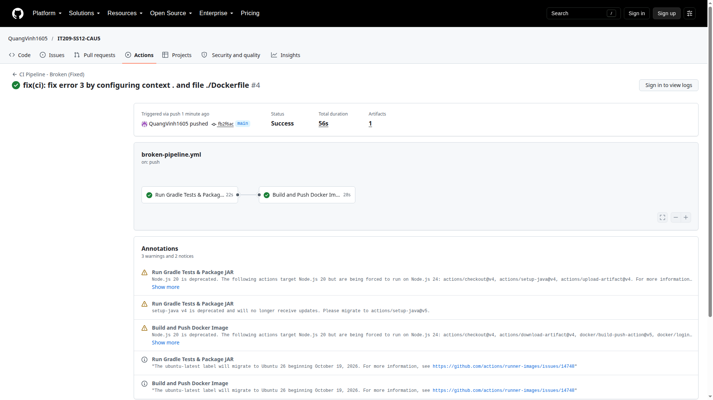

# DevOps IT209 - Session 12

## Thông tin học viên
- **Học viên:** Nguyễn Quang Vinh (Vinh Nguyen)
- **Tài khoản GitHub:** [`QuangVinh1605`](https://github.com/QuangVinh1605)
- **Repository Bài 3:** [QuangVinh1605/IT209-SS12-CAU3](https://github.com/QuangVinh1605/IT209-SS12-CAU3)
- **Repository Bài 5:** [QuangVinh1605/IT209-SS12-CAU5](https://github.com/QuangVinh1605/IT209-SS12-CAU5)

---

## Danh mục bài thực hành

### 1. [Bài 3: Tách biệt luồng CI/CD đa môi trường (Staging & Production) với GitHub Environments](homework/session_12/ex3/README.md)
- **Mục tiêu:** Quản lý hạ tầng triển khai đa môi trường với Environment Protection Rules (`Required reviewers` trên `production`).
- **Kịch bản CI/CD:** [`.github/workflows/cd-multi-env.yml`](.github/workflows/cd-multi-env.yml) (sao lưu tại [`homework/session_12/ex3/cd-multi-env.yml`](homework/session_12/ex3/cd-multi-env.yml)).
- **Minh chứng phê duyệt:**
  - *Luồng tạm dừng chờ duyệt (Waiting for review):* 
  - *Cửa sổ phê duyệt Production (Review Modal):* 
  - *Luồng hoàn tất tích xanh sau khi duyệt:* 

---

### 2. [Bài 5: Chẩn đoán và khắc phục 3 sự cố đứt gãy Pipeline CI/CD thực tế](homework/session_12/ex5/troubleshooting.md)
- **Mục tiêu:** Phân tích log lỗi thực tế trên GitHub Actions Runner và sửa chữa trực tiếp 3 lỗi:
  1. *Lỗi 1 (Permission Denied):* Thiếu quyền thực thi Gradle Wrapper -> Khắc phục: `chmod +x gradlew`.
  2. *Lỗi 2 (Authentication Failed):* Sai chính tả biến Secret (`REGISTRY_TOKKEN`) -> Khắc phục: `${{ secrets.REGISTRY_TOKEN || secrets.GITHUB_TOKEN }}`.
  3. *Lỗi 3 (Build Context Error):* Sai thư mục context (`./build`) -> Khắc phục: `context: .` và `file: ./Dockerfile`.
- **Kịch bản CI/CD đã sửa:** [`.github/workflows/broken-pipeline.yml`](.github/workflows/broken-pipeline.yml) (sao lưu tại [`homework/session_12/ex5/broken-pipeline.yml`](homework/session_12/ex5/broken-pipeline.yml)).
- **Báo cáo chi tiết:** [`homework/session_12/ex5/troubleshooting.md`](homework/session_12/ex5/troubleshooting.md).
- **Minh chứng tích xanh (Success):**
  
