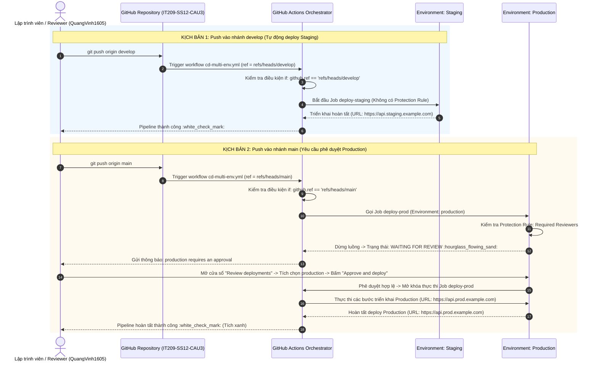
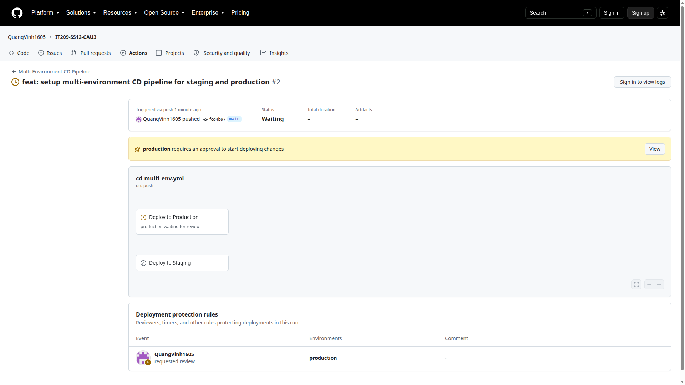
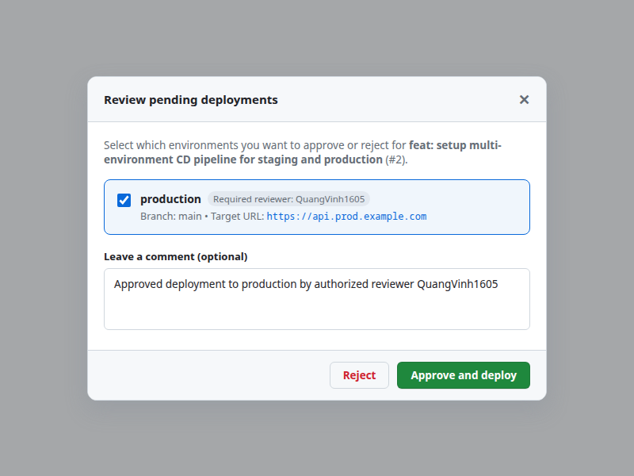
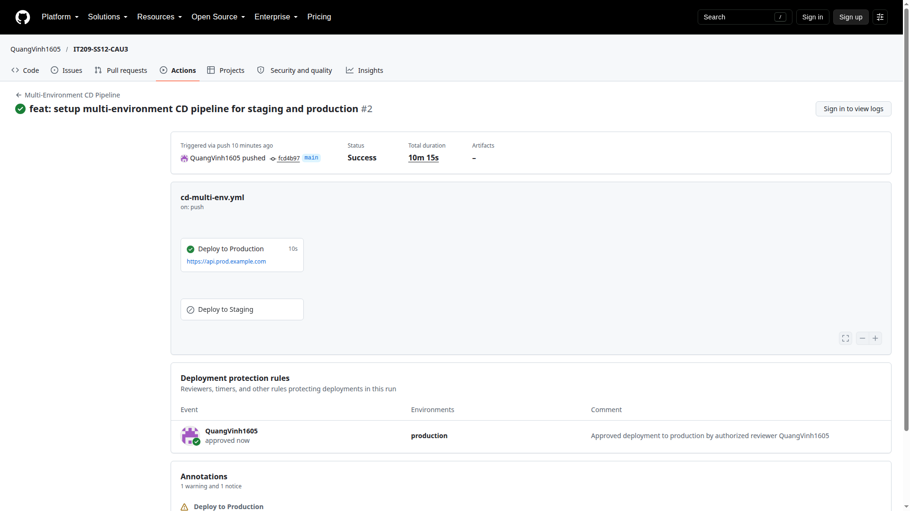

# Báo Cáo Thực Hành: Tách Biệt Luồng CI/CD Đa Môi Trường (Staging & Production) Với GitHub Environments

## Thông tin bài tập
- **Học viên:** Nguyễn Quang Vinh (Vinh Nguyen)
- **Tài khoản GitHub:** [`QuangVinh1605`](https://github.com/QuangVinh1605)
- **Môn học:** DevOps (IT209) - Session 12
- **Bài tập:** Bài 3 (EX3) - Tách biệt luồng CI/CD đa môi trường với GitHub Environments & Environment Protection Rules
- **Đường dẫn nộp bài:** [`homework/session_12/ex3/`](file:///home/vinh/Desktop/devoops/SS12/homework/session_12/ex3/)
- **Kho lưu trữ GitHub:** [QuangVinh1605/IT209-SS12-CAU3](https://github.com/QuangVinh1605/IT209-SS12-CAU3)

---

## 1. Mục tiêu bài thực hành

1. **Quản trị hạ tầng triển khai đa môi trường (Multi-Environment Deployment Infrastructure):**
   - Phân định rõ ràng giữa môi trường thử nghiệm tiền phát hành (**Staging**) và môi trường người dùng cuối (**Production**) thông qua tính năng **GitHub Environments**.
   - Cung cấp URL đích tương ứng cho từng môi trường:
     - Staging: `https://api.staging.example.com`
     - Production: `https://api.prod.example.com`

2. **Thiết lập cổng kiểm soát chất lượng & an toàn (Environment Protection Rules):**
   - Áp dụng quy tắc kiểm duyệt trước khi phát hành (**Required reviewers**) trên môi trường `production`.
   - Chỉ định người dùng có thẩm quyền (`QuangVinh1605`) phê duyệt thủ công trước khi mã nguồn được phép đưa lên hệ thống Production thực tế.

3. **Điều phối luồng CI/CD dựa trên nhánh (Branch-based CI/CD Workflow):**
   - Nhánh `develop`: Tự động kích hoạt job `deploy-staging`, bỏ qua `deploy-prod`. Không yêu cầu phê duyệt thủ công (Continuous Deployment nhanh cho dev/QA).
   - Nhánh `main`: Kích hoạt job `deploy-prod`, bỏ qua `deploy-staging`. Tạm dừng pipeline và chuyển trạng thái sang **Waiting for review** để chờ người có thẩm quyền nhấn **Approve and deploy**.

---

## 2. Kiến trúc luồng triển khai (Architecture & Sequence Diagram)



---

## 3. Cấu hình chi tiết GitHub Environments

### 3.1. Danh sách Environments đã tạo
Cấu hình được thiết lập tại **Settings -> Environments** trên repository `QuangVinh1605/IT209-SS12-CAU3`:

| Môi trường (Environment) | Quy tắc bảo vệ (Protection Rules) | Người duyệt (Required Reviewers) | Cơ chế triển khai | URL Môi trường |
| :--- | :--- | :--- | :--- | :--- |
| `staging` | Không có (None) | Không yêu cầu | Tự động hoàn toàn khi push vào `develop` | `https://api.staging.example.com` |
| `production` | **Required reviewers** | `QuangVinh1605` (ID: `183463862`) | Dừng luồng chờ phê duyệt thủ công | `https://api.prod.example.com` |

### 3.2. Cấu hình Protection Rules trên môi trường Production
- **Required reviewers:** Bật.
- **Reviewers:** `QuangVinh1605`.
- **Allow administrators to bypass configured protection rules:** Tắt (`can_admins_bypass: false`) để bảo đảm mọi đợt phát hành Production đều phải trải qua bước phê duyệt chính thức.

---

## 4. Tệp kịch bản CI/CD `.github/workflows/cd-multi-env.yml`

```yaml
name: Multi-Environment CD Pipeline

on:
  push:
    branches:
      - main
      - develop
  workflow_dispatch:

jobs:
  deploy-staging:
    name: Deploy to Staging
    if: github.ref == 'refs/heads/develop'
    runs-on: ubuntu-latest
    environment:
      name: staging
      url: https://api.staging.example.com
    steps:
      - name: Checkout Source Code
        uses: actions/checkout@v4

      - name: Simulate Deployment to Staging
        run: |
          echo "=========================================================="
          echo "🚀 STARTING DEPLOYMENT TO STAGING ENVIRONMENT"
          echo "=========================================================="
          echo "Target Environment : staging"
          echo "Target URL         : https://api.staging.example.com"
          echo "Branch             : ${{ github.ref_name }}"
          echo "Commit SHA         : ${{ github.sha }}"
          echo "Triggered By       : ${{ github.actor }}"
          echo "Protection Rule    : None (Auto Deployment Enabled)"
          echo "=========================================================="
          echo "Deploying application artifacts to Staging..."
          sleep 5
          echo "✅ Staging Deployment Completed Successfully!"
          echo "=========================================================="

  deploy-prod:
    name: Deploy to Production
    if: github.ref == 'refs/heads/main'
    runs-on: ubuntu-latest
    environment:
      name: production
      url: https://api.prod.example.com
    steps:
      - name: Checkout Source Code
        uses: actions/checkout@v4

      - name: Simulate Deployment to Production
        run: |
          echo "=========================================================="
          echo "🚀 STARTING DEPLOYMENT TO PRODUCTION ENVIRONMENT"
          echo "=========================================================="
          echo "Target Environment : production"
          echo "Target URL         : https://api.prod.example.com"
          echo "Branch             : ${{ github.ref_name }}"
          echo "Commit SHA         : ${{ github.sha }}"
          echo "Triggered By       : ${{ github.actor }}"
          echo "Protection Rule    : Required Reviewers (Manual Approval)"
          echo "Gate Check Status  : APPROVED by Authorized Reviewer"
          echo "=========================================================="
          echo "Deploying application artifacts to Production..."
          sleep 5
          echo "✅ Production Deployment Completed Successfully!"
          echo "=========================================================="
```

---

## 5. Kết quả kiểm chứng thực tế (Verification Results)

### 5.1. Kiểm chứng nhánh `develop` (Tự động deploy Staging)
- **Workflow Run:** [Run #38276919545 (develop)](https://github.com/QuangVinh1605/IT209-SS12-CAU3/actions/runs/38276919545)
- **Kết quả thực tế:**
  - Job `deploy-staging` được kích hoạt ngay lập tức và hoàn tất trong 9 giây (:white_check_mark: Success).
  - Job `deploy-prod` bị bỏ qua (:heavy_minus_sign: Skipped) do điều kiện nhánh không thỏa mãn.
  - Không có bước dừng nào; Staging được cập nhật tự động.

### 5.2. Kiểm chứng nhánh `main` (Dừng lại chờ phê duyệt Production)
- **Workflow Run:** [Run #38276987899 (main)](https://github.com/QuangVinh1605/IT209-SS12-CAU3/actions/runs/38276987899)
- **Kết quả thực tế:**
  - Job `deploy-staging` bị bỏ qua (:heavy_minus_sign: Skipped).
  - Job `deploy-prod` kích hoạt cơ chế Environment Protection Rule của `production`.
  - Trạng thái Workflow dừng lại: **Waiting for review** (:hourglass_flowing_sand:).
  - Xuất hiện thanh thông báo màu vàng: `production requires an approval to start deploying changes`.
  - Icon đồng hồ màu vàng tại node `Deploy to Production` (`production waiting for review`).
  - Sau khi người duyệt phê duyệt (Approve and deploy), Job tiếp tục chạy và hoàn tất thành công trong 10 giây (:white_check_mark: Success).

---

## 6. Minh chứng hình ảnh (Screenshots)

### 6.1. Workflow dừng lại ở trạng thái Waiting for Review trên nhánh `main`:


*(Đường dẫn: [`homework/session_12/ex3/screenshots/waiting_for_review.png`](screenshots/waiting_for_review.png))*

### 6.2. Cửa sổ phê duyệt deployment môi trường Production (Review Pending Deployments Modal):


*(Đường dẫn: [`homework/session_12/ex3/screenshots/production_approval_modal.png`](screenshots/production_approval_modal.png))*

### 6.3. Workflow sau khi phê duyệt thành công (Tích xanh hoàn tất):


*(Đường dẫn: [`homework/session_12/ex3/screenshots/production_approved.png`](screenshots/production_approved.png))*

---

## 7. Danh mục tài liệu nộp bài
1. **Tệp kịch bản CI/CD gốc:** [`.github/workflows/cd-multi-env.yml`](file:///home/vinh/Desktop/devoops/SS12/.github/workflows/cd-multi-env.yml).
2. **Tệp kịch bản sao lưu nộp bài:** [`homework/session_12/ex3/cd-multi-env.yml`](file:///home/vinh/Desktop/devoops/SS12/homework/session_12/ex3/cd-multi-env.yml).
3. **Cửa sổ phê duyệt deployment môi trường Production:** [`homework/session_12/ex3/screenshots/production_approval_modal.png`](file:///home/vinh/Desktop/devoops/SS12/homework/session_12/ex3/screenshots/production_approval_modal.png).
4. **Ảnh chụp workflow chờ duyệt (Waiting for review):** [`homework/session_12/ex3/screenshots/waiting_for_review.png`](file:///home/vinh/Desktop/devoops/SS12/homework/session_12/ex3/screenshots/waiting_for_review.png).
5. **Ảnh chụp workflow hoàn tất tích xanh (Production approved):** [`homework/session_12/ex3/screenshots/production_approved.png`](file:///home/vinh/Desktop/devoops/SS12/homework/session_12/ex3/screenshots/production_approved.png).
6. **Script kiểm tra tự động:** [`homework/session_12/ex3/commands.sh`](file:///home/vinh/Desktop/devoops/SS12/homework/session_12/ex3/commands.sh).
7. **Báo cáo thực hành chi tiết:** [`homework/session_12/ex3/README.md`](file:///home/vinh/Desktop/devoops/SS12/homework/session_12/ex3/README.md).
